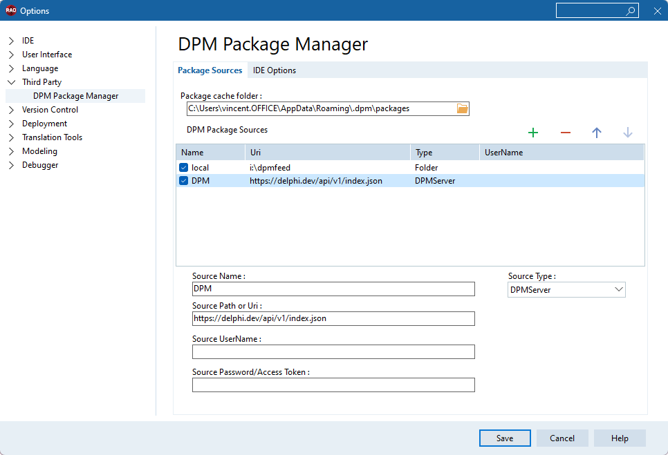

# Package Sources

A Package Source is either a folder or an HTTPS service which contains package files, and allows for searching, downloading or uploading of package files. When you first run dpm (either the command line or the ide integration), the default package source is added (https://delphi.dev/api/v2/index.json).

Multiple package sources can be defined, and they will be searched in the order they are defined. So when installing a package, if I don't specify a package version, each registered package source will be searched, and the highest version chosen. 

## Managing Package Sources

Package sources are listed in your [dpm.config](/concepts/config-files). 


**Adding a Package Source**

Adding a package source can be done from the command line, or from the IDE plugin options page (IDE options, Third Party\\DPM Package Manager).

```bat
dpm sources add -name=local -source=\\myserver\dpmsource
```



## Folder Sources

A folder source is a local folder or a network share (UNC path) holding `.dpkg` files. `dpm push` copies the package into the folder and writes its SHA-256 hash beside it, as `<package>.dpkg.sha256`. The first time a package is read, DPM also saves its spec beside it, as `<package>.dspec.yaml`, plus its icon, so later reads don't have to open the package itself.

### The folder index

On a network share, reading those small files for every package can be most of what a search costs, especially once the share has been idle. To avoid that, DPM keeps a per-user index of what they contained, in `%APPDATA%\.dpm\folder-index`. With the index, a search, the IDE's installed list and a package's details only read the share for packages that have changed.

An entry in the index is used only when the folder listing shows the package and both of the files beside it with exactly the size and modified time they had when the entry was recorded. Adding, replacing, deleting or editing any of them makes DPM read that package again.

Installing and restoring never use the index. They always read the share, as before.

Entries that haven't been used for 60 days are dropped, as are the least recently used beyond 5,000 entries for one folder and compiler. A dropped entry only means that package is read from the share again the next time it's needed.

The index is only a cache, so the `folder-index` folder can be deleted at any time; it is rebuilt as you search. To turn the index off entirely, set the `DPMFOLDERINDEX` environment variable to `off` (`0` and `false` also work). Restart the IDE after changing it.

::: tip
Pushing a package under a file name that is already in the folder replaces the package and its `.sha256` file. It also removes the `.dspec.yaml` and icon saved from the old package, so the new package's details are read from it.
:::
