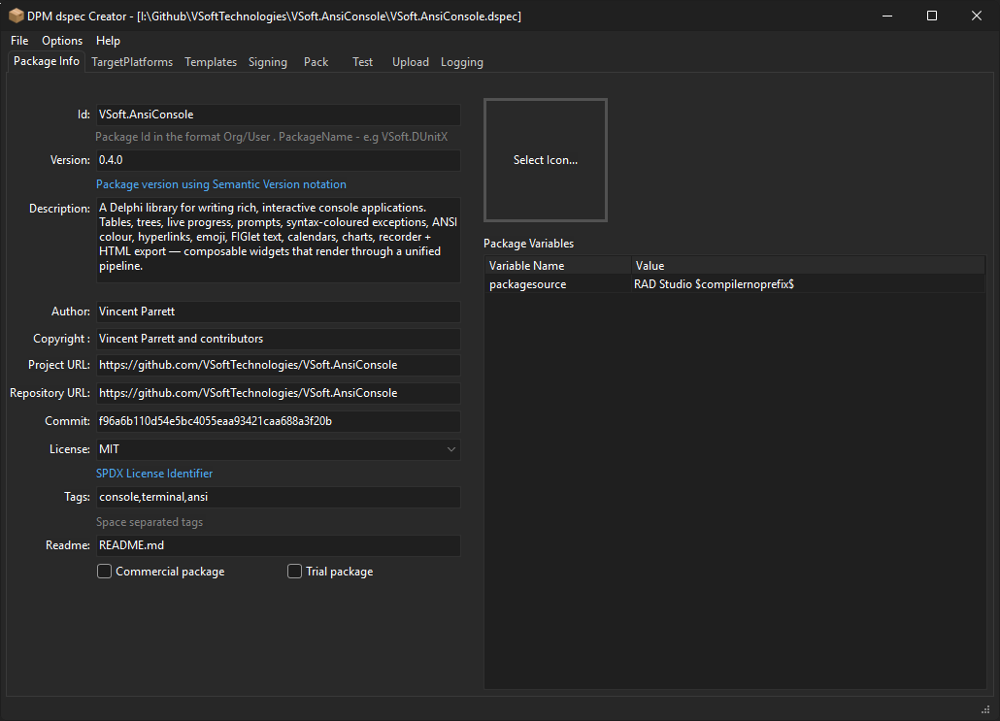
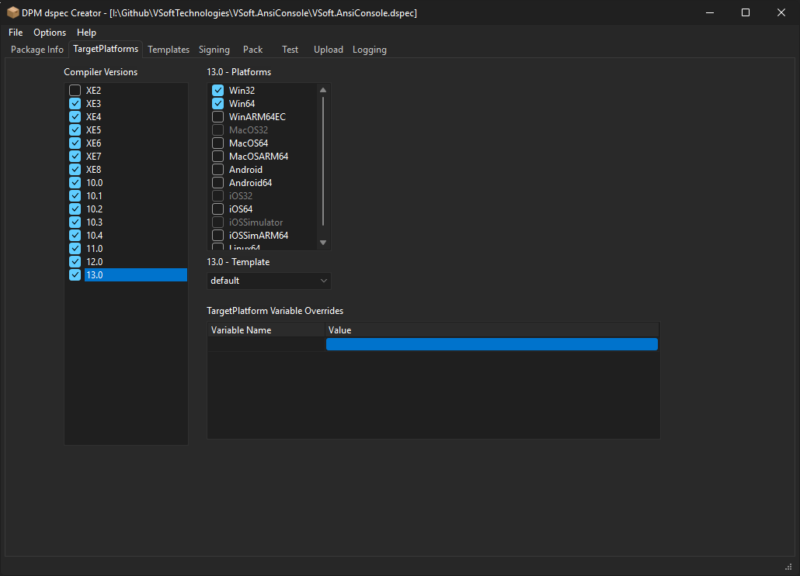
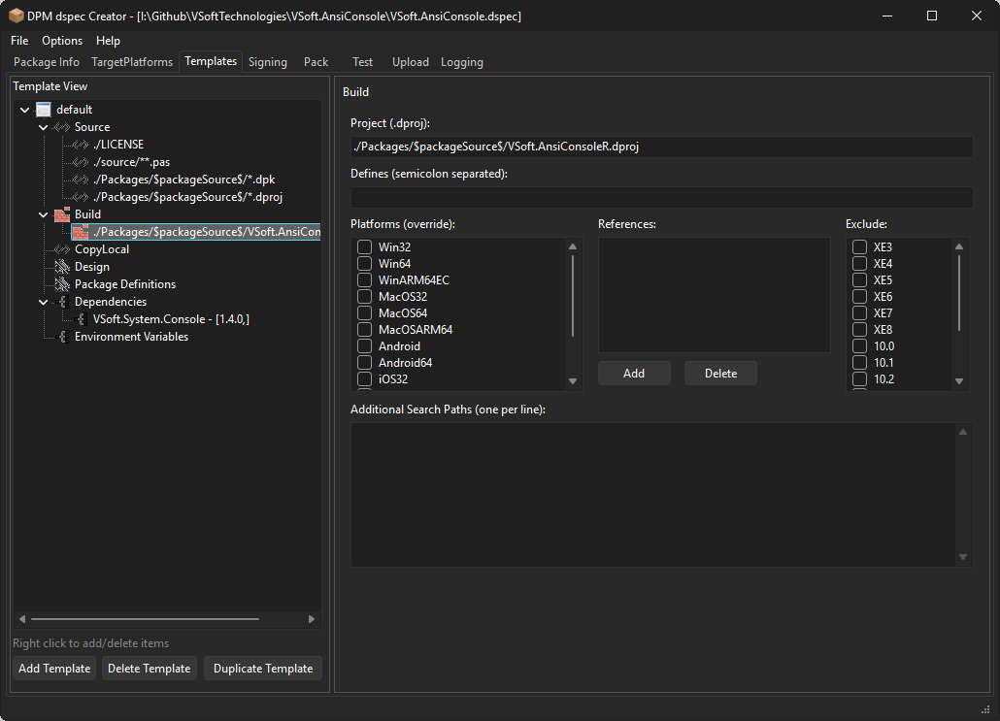
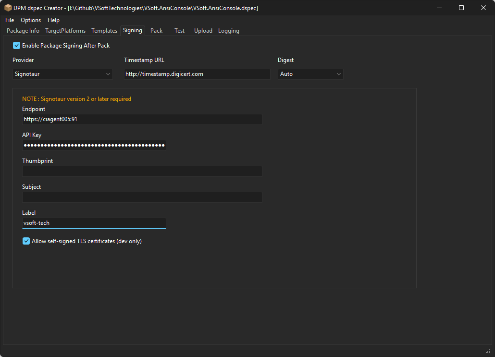
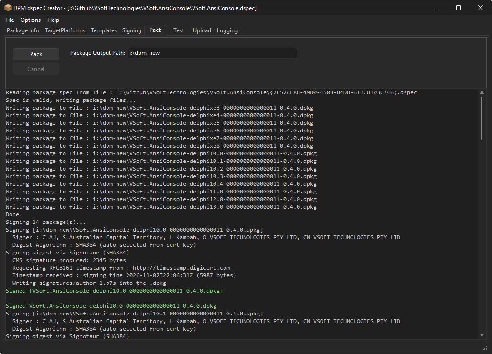
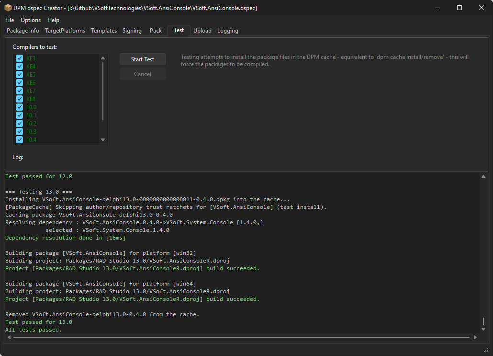
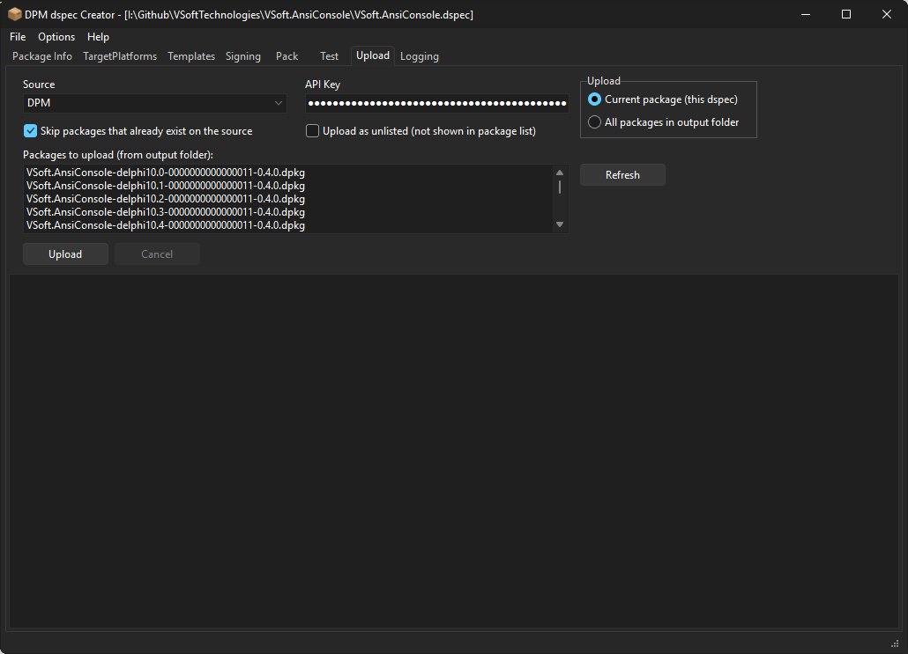

# DSpecCreator - GUI package authoring tool

DSpecCreator makes it easy to define/pack/sign/test and upload dpm packages. 

The Package info tab is where you define the package meta and (optional) package level variables

Target Platforms is where you specify which compilers/platforms the package supports, and targetplatform level variables.

Templates are where you define the contents of the package, and how it compiles, what design time packages to install etc. 

The Signing tab allows you to specify if and how the package will be signed during the pack process. DPM supports signing using Windows Certificate store, PFX files, [Signotaur](https://www.finalbuilder.com/signotaur) and Azure Key Vault (untested at this stage).

The pack tab is where we actually generate the .dpkg files (they are zip files) ready for testing/uploading.

The Test is where we confirm that the package compile correctly during install. It does the equivelant of `dpm cache install My.Package -compiler=xx` and `dpm cache remove My.Package -compiler=xx` for each compiler version the package supports. The cache install command will perform dependency resolution, and run the compile part of the package install. It is recommended you do this while developing packages. 

The upload tab is where you upload the packages to the package source. For https sources you will need an api key (from the server).

